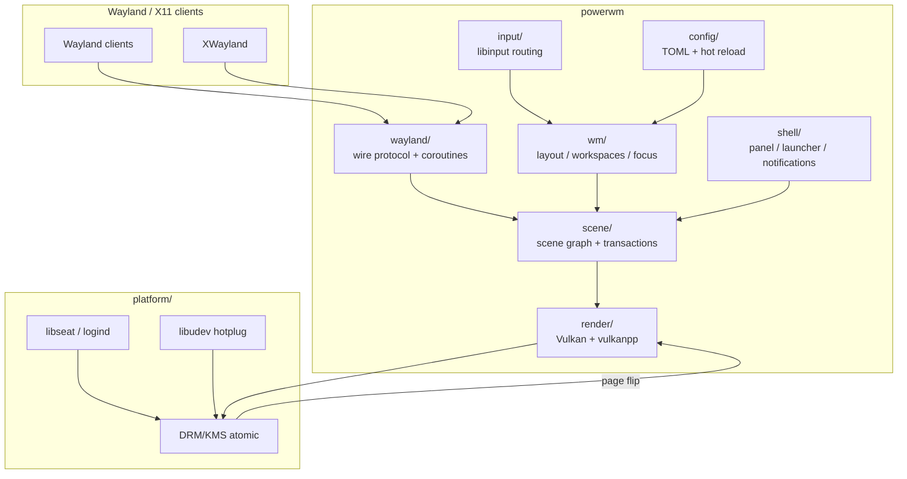

# powerwm

> A modern C++26 Wayland compositor and tiling window manager for Linux, built from
> scratch on DRM/KMS with Vulkan and a coroutine-based protocol stack.

[](https://github.com/Ennard-lu/Powerwm/actions/workflows/ci.yml)
[](LICENSE)

**Status: Phase 1 (ignition) · implementation complete, hardware validation pending · not usable as a daily desktop**

## Why powerwm

powerwm is not another configuration layer around an existing compositor. It owns the
whole graphics path: DRM/KMS modesetting, input, rendering, the Wayland wire protocol,
window policy, and the desktop shell. The project optimizes for three things:

1. **Modern C++**: C++26, coroutines, reflections, `std::expected`, concepts, ranges.
2. **Predictable performance**: one logical thread by default, damage-driven rendering,
   Vulkan, zero steady-state allocations, measurable frame budgets.
3. **A coherent desktop**: animation, rounded corners, blur, and theming designed into
   the architecture rather than bolted on later.

This is a long journey. Every phase has explicit deliverables and exit criteria.

## Hard engineering rules

These rules are enforced by CI, compile flags, and code review:

| Rule | Detail |
| --- | --- |
| **No libwayland-*** | The Wayland wire protocol, object model, marshalling, fd passing, and coroutine protocol engine are implemented in-tree |
| **No exceptions** | The whole project is compiled with `-fno-exceptions`; errors use `pwm::result<T>` and error codes |
| **Wrap every C API** | Resources are created with `create`, released with `destroy`, and enter business code through `pwm::raii`; dependent resources are created by their owner (`device.create_dumb_buffer()`) |
| **Vulkan only** | Rendering uses Vulkan through the internal `vulkanpp` RAII layer; no EGL/GLES path |
| **Namespace `pwm`** | Root namespace is `pwm`; modules use `pwm::platform::drm`, `pwm::render::vulkan`, etc. |
| **Fixed-width integers** | Business code uses `pwm::i32`, `pwm::u32`, `pwm::usize`, not `int32_t`/`uint32_t` |
| **No explanatory comments** | Code comments are English API documentation (`///`, `/**`) or SPDX only; implementation files contain no comments |
| **Small functions** | Business functions target 60 lines (hard limit 80) and at most 5 nesting levels; names must be self-explanatory |
| **Uniform declarations** | Named functions use trailing return types: `auto create() -> result<T>`; only `main`, constructors, and destructors are exempt |
| **Apache-2.0** | Every source file carries an SPDX identifier |

## Current state

The repository currently contains the Phase 0 foundation and a DRM/KMS bring-up tool:

- `src/base/` — `result`, `raii`, fatal handling, fixed-width integers, macros.
- `src/platform/drm/` — libdrm wrappers: `device`, `atomic_request`, `dumb_buffer`,
  `framebuffer`, property lookup, display modes.
- `src/platform/event/` — poll-based multi-fd event loop, `eventfd`/`timerfd` wrappers, and page-flip/input waiting primitives.
- `src/platform/input/` — libinput + libudev context with normalized keyboard, pointer, and touch events.
- `src/platform/seat/` — libseat session wrapper for device access and VT enable/disable events; the DRM tool uses it when available.
- `src/platform/udev/` — udev monitor for DRM hotplug events.
- `src/platform/headless/` — headless output skeleton with commit/page-flip accounting.
- `src/platform/gbm/` — early libgbm wrapper; will be evaluated after the Vulkan backend lands.
- `src/app/main.cpp` — application skeleton; prints version/help and never touches DRM.
- `tools/drm_bringup.cpp` — event-driven DRM/KMS demo: DRM fd, timerfd, seat dispatch, and input fd share one loop; double-buffered page flips and VT pause/resume.
- `tools/input_probe.cpp` — five-second libinput event probe for keyboard, pointer, and touch input.
- `tools/seat_probe.cpp` — five-second libseat session probe.
- `tools/probe.cpp` — read-only DRM output diagnostics (`powerwm_probe`).
- `tests/unit/` — CTest coverage for `result`, `raii`, and the multi-fd event loop.

The Wayland protocol engine, Vulkan renderer, scene graph, and window manager are not
implemented yet. They are tracked in the [roadmap](docs/roadmap.md).

## Architecture at a glance



Dependencies point downward only. `platform` does not know about `scene`; `scene` does
not know about `wm`; `wm` does not know the rendering backend. See
[docs/architecture.md](docs/architecture.md) for the full design.

## Technology stack

| Area | Choice |
| --- | --- |
| Language | C++26 (GCC 16+) |
| Build | CMake + Ninja + CMake Presets |
| Display | DRM/KMS atomic modesetting via libdrm |
| Protocol | In-tree Wayland wire protocol + C++ coroutines; no libwayland |
| Input | libinput + libudev + libseat |
| Rendering | Vulkan + internal `vulkanpp` RAII wrapper |
| Buffers | DMA-BUF export/import, KMS scanout |
| Errors | Error codes + `pwm::result<T>`, no exceptions |
| Config | TOML + atomic hot reload |
| Tests | CTest, Catch2, sanitizers, fuzzing, golden images |
| License | Apache-2.0 |

## Roadmap

| Phase | Codename | Goal | Status |
| --- | --- | --- | --- |
| P0 | Foundation | Engineering, CI, base/platform split, test and policy gates | mostly complete |
| P1 | Ignition | Stable DRM/KMS output, page flip, VT switch, hotplug | **in progress** |
| P2 | Canvas | Vulkan renderer, scene graph, DMA-BUF, damage tracking | pending |
| P3 | Language | In-tree Wayland wire protocol, coroutine engine, core protocols | pending |
| P4 | Order | Tiling layouts, workspaces, focus, keybindings, IPC | pending |
| P5 | Skin | Panel, launcher, notifications, lock screen, theming, animation | pending |
| P6 | Ecosystem | XWayland, portals, screencopy, input methods, HDR experiments | pending |
| P7 | Polish | Performance, stability, accessibility, packaging, 1.0 | ongoing |

Full milestones, deliverables, exit criteria, and risks are in
[docs/roadmap.md](docs/roadmap.md).

## Build and run

### Prerequisites

- Linux (x86_64 initially)
- GCC 16 or newer (C++26 reflection and coroutines)
- CMake 3.25 or newer
- Ninja
- libdrm development headers
- Vulkan loader and drivers (for upcoming phases)

The reproducible container is the recommended environment:

```bash
docker build -t powerwm-dev -f containers/dev.Dockerfile .
docker run --rm -it -v "$PWD:/workspace" -w /workspace powerwm-dev bash
```

### Build

```bash
cmake --preset dev
cmake --build --preset dev
ctest --preset dev --output-on-failure
```

Presets:

| Preset | Purpose |
| --- | --- |
| `dev` | debug build, assertions enabled |
| `release` | optimized build |
| `asan` | AddressSanitizer + UndefinedBehaviorSanitizer |

### Run

```bash
./build/dev/powerwm --version
./build/dev/powerwm --help
./build/dev/powerwm --build-info
```

The application skeleton is safe to run in a normal session. The DRM tool takes over a
DRM device, so run it from a TTY with the required permissions:

```bash
sudo ./build/dev/powerwm_drm_bringup
sudo ./build/dev/powerwm_input_probe
./build/dev/powerwm_seat_probe
./build/dev/powerwm_probe
```

## Build metadata

`cmake/PowerWMBuildInfo.cmake` captures the following at configure time and generates
`powerwm/build_info.hpp`:

- project version;
- full and short git commit, branch, `git describe`, dirty state;
- UTC build timestamp;
- build type, compiler id/version/path, generator, C++ standard;
- compiler flags, build directory, enabled features;
- target system and processor.

The application prints it with:

```bash
./build/dev/powerwm --build-info
```

`--version` prints a short summary containing the version, commit, branch, and dirty
state.

## Repository layout

```text
powerwm/
├── cmake/                  # CMake modules and build-info template
├── containers/             # reproducible development container
├── docs/                   # Chinese design docs, roadmap, ADRs
├── src/
│   ├── app/                # application entry point
│   ├── base/               # result, raii, fatal, types, macros
│   └── platform/
│       ├── drm/            # libdrm wrappers
│       └── gbm/            # early libgbm wrapper
├── tests/                  # unit/integration/golden/fuzz/bench
└── tools/                  # DRM bring-up tool and policy checks
```

## Documentation

The design documentation is currently written in Chinese:

- [Chinese README](docs/README.zh-CN.md)
- [Documentation index](docs/README.md)
- [Roadmap](docs/roadmap.md)
- [Architecture](docs/architecture.md)
- [Coding style](docs/coding-style.md)
- [Testing strategy](docs/testing.md)
- [Phase 1 validation](docs/phase-1-validation.md)
- [CI/CD](docs/ci-cd.md)
- [Architecture decision records](docs/decisions/)

Code identifiers, commits, comments, and this README are in English.

## Contributing

1. Read the roadmap and confirm the change belongs to the current phase.
2. Open an issue before architectural changes; significant decisions need an ADR.
3. Follow the coding style, keep functions small, and avoid explanatory comments.
4. Run the local gates before opening a pull request:

```bash
bash tools/check_policy.sh
python3 tools/check_comments.py
clang-format --dry-run --Werror $(git ls-files '*.cpp' '*.hpp')
```

See [CONTRIBUTING.md](CONTRIBUTING.md) for details.

## License

Apache License 2.0. See [LICENSE](LICENSE).
