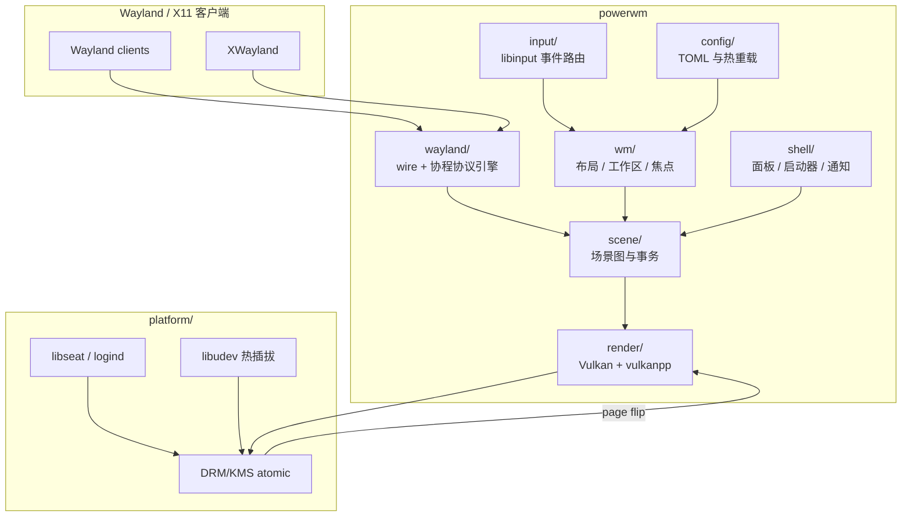

# powerwm

> 一个直接运行在 Linux DRM/KMS 之上、使用现代 C++ 从零构建的 Wayland 合成器与平铺窗口管理器。

**状态：Phase 2（画布）· Vulkan 基础起步 · 尚不可日常使用**
**许可证：Apache-2.0**

powerwm 的目标不是再做一个配置层，而是构建一条完整、可控、可测量的图形栈：
从内核模式设置、输入、渲染、Wayland 协议，到窗口策略与桌面外壳。它追求三件事：

1. **现代**：C++26、`std::expected`、`std::span`、概念、反射、协程、模块化设计。
2. **高性能**：单线程事件循环起步、Vulkan 渲染、按损坏区域绘制、零稳态分配、帧预算可测量。
3. **美观**：动画、圆角、模糊与主题系统从架构第一天就被考虑，而不是事后拼贴。

这会是一场漫长的征程。我们按阶段推进，每个阶段都有明确的交付物与退出标准。

---

## 硬性工程规则

这些规则不是建议，而是进入仓库的门槛（CI 与代码审查共同保证）：

| 规则 | 说明 |
| --- | --- |
| **不依赖 libwayland-\*** | 自行实现 Wayland wire protocol、对象模型与消息编解码，使用 C++ 协程组织协议处理 |
| **禁用异常** | 全项目 `-fno-exceptions`；错误通过 `pwm::result<T>` / 错误码返回，禁止 `throw` / `try` / `catch` |
| **C API 必须封装** | 任何 C 资源都必须有 `create` / `destroy` 包装，并通过 `pwm::raii`（或专用 RAII 类型）进入业务代码；依赖资源由宿主创建 |
| **函数声明** | 具名函数统一使用 `auto foo() -> T` 尾置返回类型 |
| **Vulkan 后端** | 渲染通过内部 `vulkanpp` 封装层使用 Vulkan，不暴露裸 `Vk*` 句柄 |
| **命名空间 `pwm`** | 根命名空间简称 `pwm`，基础类型/RAII 位于 `pwm`，模块位于 `pwm::platform::drm`、`pwm::render::vulkan` |
| **定宽整数别名** | 使用 `pwm::i32` / `pwm::u32` / `pwm::usize` 等，不在业务代码写 `int32_t` / `uint32_t` |
| **注释** | 代码内禁止解释性注释；只允许英文 API 文档注释与 SPDX 头 |
| **函数规模** | 业务函数 ≤ 60 行（硬上限 80），嵌套 ≤ 5 层；名字必须自明 |
| **许可证** | Apache-2.0，源文件使用 SPDX 标识 |

---

## 当前仓库里有什么

当前代码是一个 **DRM/KMS 点灯原型**，用于验证工具链与底层封装，不是窗口管理器：

- `src/base/`：`result`、`raii`、`fatal`、定宽整数、宏等基础设施，命名空间 `pwm`。
- `src/platform/drm/`：`libdrm` 封装（`device`、`atomic_request`、`dumb_buffer`、`framebuffer`、属性查找、page flip）。
- `src/platform/event/`：基于 `poll` 的多 fd 事件循环、`eventfd`/`timerfd` 封装、page flip/输入等待原语。
- `src/platform/input/`：`libinput` + `libudev` 上下文，标准化键盘/指针/触摸事件。
- `src/platform/seat/`：`libseat` 会话封装，设备打开与 VT enable/disable 事件；DRM 工具可用时走该路径。
- `src/platform/udev/`：DRM 热插拔 udev monitor。
- `src/platform/headless/`：headless 输出骨架与提交/翻页计数。
- `src/render/vulkanpp/`：Vulkan instance、物理设备选择、逻辑设备与队列 RAII 封装。
- `src/platform/gbm/`：早期 `libgbm` 封装，Vulkan 后端落地后评估移除。
- `src/app/main.cpp`：应用骨架，无参数时打印版本与帮助，不触碰 DRM。
- `tools/drm_bringup.cpp`：事件驱动 DRM/KMS demo，DRM fd、timerfd、seat dispatch 与 input fd 共用事件循环；双缓冲 page flip 与 VT 暂停/恢复。
- `tools/input_probe.cpp`：5 秒输入事件探针。
- `tools/seat_probe.cpp`：5 秒 seat 会话探针。
- `tools/probe.cpp`：只读 DRM 输出诊断（`powerwm_probe`）。
- `tools/vulkan_probe.cpp`：Vulkan instance/device 诊断（`powerwm_vulkan_probe`）。
- CMake 目标：`powerwm_core`（静态库）、`powerwm`（应用）、`powerwm_drm_bringup`（工具）、`powerwm_tests`。
- 当前构建已启用 `-fno-exceptions`；Vulkan 渲染栈与自研 Wayland 协议栈尚未接入，属于 Phase 2/3。

> 本次文档基于本地环境验证：GCC 16.2.1、CMake 4.5.1、Ninja 1.13.2、libdrm 2.4.134、GBM 26.3.1。presets `dev`/`release`/`asan` 均已通过构建与冒烟测试。

> ⚠️ `powerwm_drm_bringup` 会接管 DRM 设备。请切换到 TTY 并使用有权限的用户执行，不要在正在使用的桌面会话中直接运行。

### 构建原型

依赖（Arch Linux）：

```bash
sudo pacman -S --needed cmake ninja gcc pkgconf libdrm vulkan-icd-loader vulkan-headers mesa
```

依赖（Debian/Ubuntu）：

```bash
sudo apt install cmake ninja-build g++ pkg-config libdrm-dev libvulkan-dev \
  mesa-vulkan-drivers
```

> 如果发行版的 `g++` 低于 16（例如 Ubuntu 24.04），请使用
> [`containers/dev.Dockerfile`](../containers/dev.Dockerfile) 或手动安装 GCC 16。
> C++26 反射是硬性依赖。

构建：

```bash
cmake --preset dev
cmake --build --preset dev
ctest --preset dev --output-on-failure
```

产物：`build/dev/powerwm`；DRM 点灯工具为 `build/dev/powerwm_drm_bringup`。

```bash
./build/dev/powerwm --version
./build/dev/powerwm --build-info
sudo ./build/dev/powerwm_drm_bringup [frame-count]
./build/dev/powerwm_input_probe
./build/dev/powerwm_seat_probe
./build/dev/powerwm_probe
./build/dev/powerwm_vulkan_probe
```

### 构建信息

`cmake/PowerWMBuildInfo.cmake` 在配置阶段采集 git commit、分支、dirty 状态、UTC 构建时间、
编译器/CMake 生成器、C++ 标准、编译参数、构建目录与启用特性，生成
`build/<preset>/generated/powerwm/build_info.hpp`。可通过 `--build-info` 打印。

> C++26 反射需要 **GCC 16+**。Clang 在支持 `std::meta` 之前不是受支持的主编译器。
> 推荐使用 `containers/dev.Dockerfile` 获得可复现环境。

---

## 设计支柱

| 支柱 | 含义 | 可验证目标 |
| --- | --- | --- |
| 原生 | 直接使用 DRM/KMS + libinput + 自研 Wayland 协议栈，不依赖 wlroots/libwayland | 无 wlroots/libwayland 链接；完全掌控帧生命周期 |
| 低延迟 | 输入到光子路径短，损坏驱动渲染 | 1080p@60 输入到呈现 P99 < 16.7 ms |
| 可预测 | 单线程状态机、显式事务、无隐藏分配 | 稳态帧堆分配次数 = 0 |
| 可组合 | 协议、场景、策略、外壳分层，依赖单向 | 模块依赖图无环；核心可 headless 测试 |
| 美观 | 统一动画/材质/主题管线 | 所有动画可被合成器统一调度与降级 |
| 可维护 | 严格规范、CI 门禁、ADR 决策记录 | main 始终绿；关键决策有据可查 |

---

## 技术栈

| 领域 | 选择 | 说明 |
| --- | --- | --- |
| 语言 | C++26 | GCC 16+，反射用于协议/属性/配置零样板映射，协程用于异步协议 |
| 构建 | CMake + Ninja + Presets | 可复现构建，CI 与本地一致 |
| 显示 | DRM/KMS atomic | 直接管理 CRTC/connector/plane，支持 page flip |
| 合成协议 | 自研 wire protocol | 不使用 libwayland-*；自行实现对象模型、编解码、fd 传递与协程调度 |
| 输入 | libinput + libudev + libseat | 热插拔、VT 切换、权限委托 |
| 渲染 | Vulkan + `vulkanpp` | 内部 RAII 封装层；不使用 EGL/GLES |
| 缓冲 | DMA-BUF | Vulkan external memory ↔ KMS scanout，零拷贝 |
| 错误处理 | 错误码 + `pwm::result<T>` | `-fno-exceptions`，禁止异常控制流 |
| 配置 | TOML + 热重载 | 人类可读，错误定位清晰 |
| 测试 | CTest + Catch2 + Sanitizers + Fuzz | 单元、headless 集成、金图、协议模糊测试 |
| CI/CD | GitHub Actions（容器化 GCC 16） | 格式、构建、测试、消毒器、发布 |
| 许可证 | Apache-2.0 | SPDX 标识，见 `LICENSE` |

> 选型理由与替代方案见 [`docs/decisions/`](decisions/)。

---

## 架构一览



**单向依赖规则**：`platform` 不知道 `scene`；`scene` 不知道 `wm`；`wm` 不知道具体渲染后端。
详见 [`docs/architecture.md`](architecture.md)。

---

## 路线图摘要

| 阶段 | 代号 | 目标 | 状态 |
| --- | --- | --- | --- |
| P0 | 地基 | 工程化、CI、目录重构、测试骨架、ADR | **进行中** |
| P1 | 点亮 | DRM/KMS 稳定出图、page flip、VT 切换、热插拔 | 实现完成，验收中 |
| P2 | 画布 | Vulkan/vulkanpp 渲染器、场景图、DMA-BUF、损坏跟踪 | **进行中** |
| P3 | 语言 | 自研 Wayland wire protocol、协程协议引擎、xdg-shell、输入、剪贴板 | 待开始 |
| P4 | 秩序 | 平铺布局、工作区、焦点、键位、IPC | 待开始 |
| P5 | 肌肤 | 面板、启动器、通知、锁屏、主题、动画 | 待开始 |
| P6 | 生态 | XWayland、portal、截屏、输入法、HDR 实验 | 待开始 |
| P7 | 磨砺 | 性能、稳定性、可访问性、打包、1.0 | 持续 |

完整里程碑、交付物与退出标准见 [`docs/roadmap.md`](roadmap.md)。

---

## 质量门禁

`main` 分支必须始终满足：

- `clang-format` 检查通过；
- Debug 与 Release 构建通过；
- 单元测试与 headless 集成测试通过；
- ASan + UBSan 构建与测试通过；
- `-fno-exceptions` 构建通过，代码中无 `throw` / `try` / `catch`；
- 注释策略通过：无解释性注释，API 注释为英文；
- 业务函数 ≤ 80 行、嵌套 ≤ 5 层；
- 无 `libwayland-*` 依赖，协议层测试通过；
- 所有 C API 均通过 `create`/`destroy` + RAII 封装进入业务层；
- 新增公开 API 有文档与测试；
- 关键路径变更附带性能数据（或说明为何无需）。

当前 CI 已覆盖格式、策略扫描、双配置构建与消毒器测试；静态分析与模糊测试会在后续阶段接入。
详见 [`docs/ci-cd.md`](ci-cd.md) 与 [`docs/testing.md`](testing.md)。

---

## 文档

| 文档 | 内容 |
| --- | --- |
| [docs/README.md](README.md) | 文档索引与阅读顺序 |
| [docs/roadmap.md](roadmap.md) | 阶段、里程碑、风险与退出标准 |
| [docs/architecture.md](architecture.md) | 分层、线程模型、帧生命周期、目录规划 |
| [docs/coding-style.md](coding-style.md) | C++26 编码规范、错误处理、并发、性能约定 |
| [docs/testing.md](testing.md) | 测试金字塔、性能预算、模糊测试 |
| [docs/phase-1-validation.md](phase-1-validation.md) | Phase 1 硬件验收清单与当前结果 |
| [docs/ci-cd.md](ci-cd.md) | 流水线、分支策略、发布流程、本地复现 |
| [docs/decisions/](decisions/) | 架构决策记录（ADR） |
| [CHANGELOG.md](../CHANGELOG.md) | 版本变更记录 |
| [CONTRIBUTING.md](../CONTRIBUTING.md) | 贡献流程与 PR 清单 |

---

## 参与

这是一场长期工程。欢迎从以下方式开始：

1. 阅读路线图，认领一个 Phase 0/1 的 `good first issue`。
2. 先开 issue 讨论设计，再提交 PR；架构级变更需要 ADR。
3. 遵循 [`docs/coding-style.md`](coding-style.md)，保持提交小而可回滚。
4. 任何性能声明都要有可复现的测量方法。

提交信息使用 Conventional Commits，例如：

```text
feat(drm): add atomic page-flip completion tracking
fix(input): avoid duplicate key events on VT switch
docs(roadmap): clarify Phase 3 protocol scope
```

---

## 许可

本项目采用 **Apache License 2.0**，见 [`LICENSE`](../LICENSE)。

贡献即表示你同意以 Apache-2.0 授权你的贡献。源文件使用
`SPDX-License-Identifier: Apache-2.0` 标识；第三方代码必须保留其原始许可证与版权声明。

---

**powerwm** —— 慢就是快，先把地基打牢。

> English README: [../README.md](../README.md)
