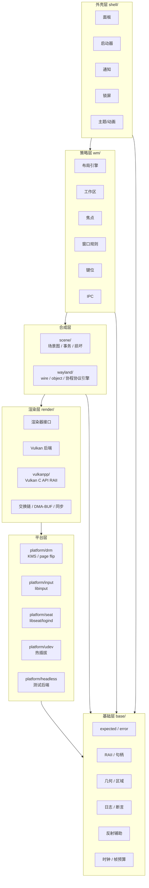
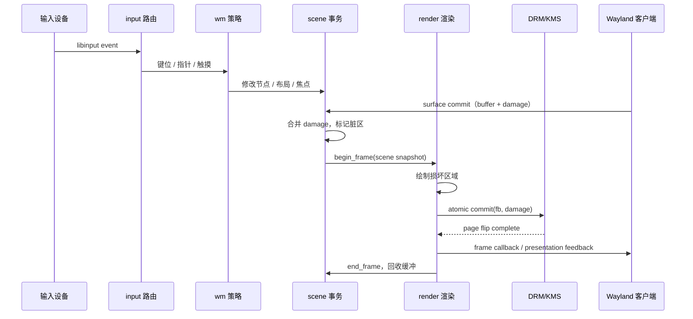

# powerwm 架构

> 状态：目标架构（Phase 0 设计），当前代码仍是原型。
> 本文描述**要建成什么**，以及为什么这样分层；实现进度见 [roadmap.md](roadmap.md)。

---

## 1. 设计目标与约束

### 目标

1. **直接掌控帧生命周期**：从输入事件、场景更新、渲染到原子提交与 page flip，路径可见、可测、可优化。
2. **可组合而非可配置**：策略（布局、焦点、键位）与机制（场景、渲染、协议）分离。
3. **单线程正确性优先**：默认只有一个逻辑线程，降低状态机复杂度；性能不足时再有证据地并行化。
4. **后端可替换**：DRM/KMS、headless、未来的 nested 后端实现同一接口。
5. **协议与策略解耦**：Wayland 对象只负责协议语义，不决定窗口怎么摆。

### 约束

- 仅支持 Linux（DRM/KMS、libinput、logind/seatd）。
- 主编译器 GCC 16+，语言标准 C++26。
- 不使用 wlroots、Mutter、KWin 等现成合成器框架。
- **不使用 `libwayland-*`**：wire protocol、对象模型、消息编解码、fd 传递全部自研。
- **禁用异常**：全项目 `-fno-exceptions`，错误通过 `result<T>` / 错误码传递。
- **渲染使用 Vulkan**，通过内部 `vulkanpp` RAII 封装层，不使用 EGL/GLES。
- **所有 C API 必须封装**：`create` 申请、`destroy` 释放，并经 `raii` 进入业务层。
- 不把 root 作为运行前提；通过 `libseat` 获取设备权限。
- 核心逻辑必须能在 headless 环境测试。

---

## 2. 分层



### 依赖规则（必须由 CI 或代码审查保证）

- **只能向下依赖**：上层可以调用下层，下层不得反向依赖上层。
- `base` 不依赖任何项目模块，也不依赖 Wayland/DRM/Vulkan。
- `platform` 不知道 `scene`、`wm`、`shell`。
- `render` 只认识“可绘制资源”和“帧”，不认识 Wayland 表面或窗口；`vulkanpp` 只认识 Vulkan C API。
- `wayland` 只做协议翻译：把客户端请求变成场景操作，把场景状态变成协议事件。
- `wm` 不直接调用渲染器；它修改场景与策略状态。
- `shell` 是普通场景使用者，不获得特权旁路。
- 业务代码不得直接包含 `<vulkan/*.h>`、`<drm/*.h>`、`<wayland-*.h>` 或调用裸 C API；必须经过对应封装层。

> 违反依赖规则通常意味着抽象放错了层。先改设计，不要用 `#include` 绕过。

---

## 3. 目录规划

```text
powerwm/
├── CMakeLists.txt
├── CMakePresets.json
├── cmake/
│   ├── modules/                 # Find*.cmake
│   └── PowerWMHelpers.cmake     # 警告、 sanitizer、安装辅助
├── containers/
│   └── dev.Dockerfile           # 可复现开发环境（GCC 16）
├── docs/
├── include/pwm/                 # 对外可见（极少）头文件
├── protocols/                   # vendored Wayland XML（记录来源与版本）
├── src/
│   ├── app/                     # 应用骨架、参数解析、生命周期
│   │   └── main.cpp
│   ├── base/                    # result / raii / fatal / types / macros
│   ├── event/                   # 目标：epoll 事件循环 + 协程调度器
│   ├── platform/
│   │   ├── drm/                 # device / atomic_request / buffers / lookup
│   │   ├── gbm/                 # 早期 GBM 封装（Vulkan 落地后评估移除）
│   │   ├── event/               # poll 等待；epoll/timerfd/signalfd 封装
│   │   ├── socket/              # 目标：socket/recvmsg/sendmsg/SCM_RIGHTS
│   │   ├── input/               # libinput + libudev 事件上下文
│   │   ├── seat/                # libseat 会话与设备打开
│   │   ├── udev/                # 目标：libudev
│   │   └── headless/            # 目标：测试后端
│   ├── render/
│   │   ├── vulkan/              # 目标：Vulkan 合成后端
│   │   └── vulkanpp/            # 目标：Vulkan C API RAII 封装
│   ├── scene/
│   ├── wayland/
│   │   ├── wire/                # 目标：消息头、编解码、SCM_RIGHTS
│   │   ├── object/              # 目标：对象表、ID、版本、生命周期
│   │   ├── protocol/            # 目标：XML → C++ 描述符生成结果
│   │   └── globals/             # 目标：wl_compositor / xdg_shell 等
│   ├── wm/
│   ├── shell/
│   ├── config/
│   └── ipc/
├── tests/
│   ├── unit/
│   ├── integration/
│   ├── golden/
│   ├── fuzz/
│   └── bench/
└── tools/
    ├── drm_bringup.cpp          # DRM/KMS 点灯工具
    ├── check_policy.sh          # 仓库策略检查
    └── check_comments.py        # 注释策略检查
```

### 当前原型到目标结构的映射

| 现在 | 目标 | 说明 |
| --- | --- | --- |
| `src/base/` | `src/base/` | 已完成；`pwm` 基础设施 |
| `src/platform/drm/` | `src/platform/drm/` | 已完成；`pwm::platform::drm` |
| `src/platform/gbm/` | `src/platform/gbm/` 或移除 | 早期封装；Vulkan 落地后评估 |
| `src/app/main.cpp` | `src/app/main.cpp` | 已完成；应用骨架 |
| `powerwm_core` + `powerwm` | 保持 | 已完成；核心可被测试链接 |
| `src/event/` | 待新增 | epoll + 协程调度器 |
| `src/render/vulkanpp/` | 待新增 | Vulkan C API 的 `create`/`destroy` + RAII 封装 |

---

## 4. 线程模型

### 默认：单逻辑线程

```text
┌────────────────────────────── 主事件循环 ──────────────────────────────┐
│ pwm::event_loop (epoll)                                                │
│  ├─ Wayland 客户端 socket：可读/可写、协程恢复                          │
│  ├─ DRM fd：page flip / vblank                                        │
│  ├─ libinput fd：输入事件                                              │
│  ├─ libseat fd：会话事件                                               │
│  ├─ udev monitor：热插拔                                              │
│  ├─ timerfd：动画、重复键、帧截止                                     │
│  ├─ signalfd：SIGINT/SIGTERM/SIGCHLD                                  │
│  └─ IPC socket：控制请求                                              │
└────────────────────────────────────────────────────────────────────────┘
```

当前 Phase 1 使用 `platform/event` 的 `poll` 封装等待 DRM page flip；完整的 epoll 协程调度器在 Phase 2/3 实现。

**不变量**

- 所有场景、窗口、协议对象的状态只在主线程读写。
- 主线程不做阻塞 I/O；磁盘/网络操作通过异步任务或独立线程，结果回投递。
- 渲染默认在主线程；若引入渲染线程，必须使用单生产者单消费者队列，且场景快照不可变。
- 信号处理只写 `signalfd`/标志位，不直接调用复杂逻辑。
- 协程只能在拥有 `event_loop` 的线程上恢复；禁止跨线程直接 `resume`。

### 4.1 协程运行时

协议层不使用 `libwayland` 的回调/`wl_event_loop`，而是构建项目自己的异步模型：

```cpp
namespace pwm::event {

template <typename T = void>
class task;

task<void> client_session(wayland::connection& conn);
task<message> read_message(wayland::connection& conn);
task<void> wait_readable(fd handle);

}
```

设计约束：

- `task<T>` 是**惰性**的：创建不执行，`start()` / `co_await` 才推进。
- 错误通过 `task<T>` 内部保存的 `result<T>` 传播；`co_await` 在失败时短路，不抛异常。
- 所有挂起点必须注册到 `event_loop`，并由 fd 事件、定时器或显式 `resume` 唤醒。
- 协程生命周期由事件循环或父任务持有；禁止 detach，禁止在析构中隐式 resume。
- 一个客户端连接一个 `client_session` 协程；协议对象的状态仍归主线程所有。
- 可取消：连接断开时取消其协程链，取消是错误码的一种，不是异常。

### 4.2 不使用 libwayland 的代价

| 项目 | 需要自研 | 风险 |
| --- | --- | --- |
| wire 格式 | 消息头、参数编码、版本、opcode | 与规范不一致会导致客户端无法连接 |
| fd 传递 | `sendmsg`/`recvmsg` + `SCM_RIGHTS` | fd 泄漏、越界、权限问题 |
| 对象模型 | ID 分配、销毁、版本、接口表 | 悬垂对象、协议错误处理 |
| 协议描述 | XML 解析/代码生成（替代 `wayland-scanner`） | 生成器自身 bug |
| 事件循环 | epoll + 协程调度 + 定时器 | 饥饿、取消、重入 |
| 测试 | 自研测试客户端与协议 fuzz | 兼容性覆盖不足 |

因此协议层需要比原计划更多的测试与更严格的 fuzz；见 [testing.md](testing.md)。

### 何时并行化

只有在测量证明主线程无法满足帧预算时才引入：

| 候选 | 前置条件 | 复杂度 |
| --- | --- | --- |
| 渲染线程 | CPU 渲染/编码占满主线程 | 中 |
| 客户端缓冲导入/导出 | DMA-BUF 映射成为瓶颈 | 高 |
| 截图/录屏编码 | 影响主循环 | 中（独立进程优先） |

优先把重活放到**独立进程**（如 portal 截图编码），而不是给合成器加锁。

---

## 5. 帧生命周期



### 帧调度规则

1. **vsync 驱动**：没有 page flip 完成事件时，不提交下一帧（避免排队）。
2. **空闲即停**：无动画、无输入、无新 damage 时，不渲染、不唤醒。
3. **合并提交**：同一轮事件循环内的多次状态变更合并为一次提交。
4. **动画不阻塞输入**：输入事件优先处理；动画使用绝对时间戳，丢帧不改变速度。
5. **降级**：帧预算超限时，按策略关闭模糊/阴影/动画，并记录一次降级事件。

### 损坏（damage）三级模型

| 级别 | 来源 | 合并方式 |
| --- | --- | --- |
| 表面损坏 | 客户端 `wl_surface.damage` / buffer 更新 | 表面本地坐标系，含缩放 |
| 场景损坏 | 节点移动/变换/透明度/层级变化 | 旧包围盒 ∪ 新包围盒 |
| 输出损坏 | 多表面合成结果 | 屏幕坐标系，限制到输出区域 |

最终提交给 KMS 的 damage 必须是**保守的**：宁可多画，不可漏画。正确性优先于省电。

---

## 6. 核心模块

### 6.1 `base/` — 基础设施

- `result<T>`：`std::expected<T, error>`；`error` 由 `error_code` + 静态消息/上下文组成，不依赖异常。
- `raii<T, Args...>`：C 资源统一入口；类型必须提供 `valid()` 与 `destroy(args...)`。
- `handle<T, Deleter>`：fd/mmap/句柄等轻量所有权包装；禁止裸 `close/free/destroy`。
- `geometry`：`point`、`size`、`rect`、`region`（整数与浮点版本），提供交集/并集/包含。
- `log`：分类 + 级别 + 结构化字段；热路径默认关闭。
- `assert`：仅用于不变量；可恢复错误走 `result`。
- `meta`：C++26 反射辅助；所有反射用法集中在此，便于回退与编译器适配。
- `time`：单调时钟、帧预算、动画时间轴。
- 定宽整数别名：`i8/i16/i32/i64`、`u8/u16/u32/u64`、`f32/f64`、`usize/isize`。

### 6.1.1 C API 封装契约

- 任何 C 资源都必须有 `create` / `destroy` 包装，并通过 `pwm::raii` 或专用 RAII 类型进入业务层。
- 裸句柄只允许存在于封装实现内部；业务层不直接包含 C 头文件或调用 C API。
- `destroy` 必须幂等、`noexcept`；`create` 失败返回 `result<raii<T>>`。
- 依赖其他对象的资源由宿主创建，例如 `device.create_dumb_buffer()`、`device.create_framebuffer()`；不要在依赖类型上提供 `dependent::create(owner, ...)`。
- 允许直接调用 C API 的目录：`base/`、`platform/`、`render/vulkanpp/`。
- 详细的命名、测试与检查规则见 [coding-style.md](coding-style.md) 与 [ADR-0009](decisions/0009-c-api-wrapping.md)。

### 6.2 `platform/drm/`

职责：把内核 KMS 变成一个“输出 + 提交”接口。

- 设备发现与能力探测（atomic、universal planes、格式/修饰符）。
- connector/CRTC/plane 建模；首选模式与 EDID。
- 原子请求构建器：属性 ID 缓存，避免每帧字符串查找。
- page flip 事件、vblank、DPMS。
- 恢复：master 丢失、VT 切换、输出热插拔。

**不负责**：画什么、窗口怎么摆、Wayland 协议。

### 6.3 `platform/input/`

- `libinput` 生命周期、设备热插拔、设备分组。
- 事件标准化：`key_event`、`pointer_motion`、`button_event`、`axis_event`、`touch_event`、`gesture_event`。
- 键盘布局通过 `xkbcommon`；支持重复键、组合键、led 状态。
- 输入路由：焦点表面、抓取、快捷键拦截优先级。

### 6.4 `render/` 与 `vulkanpp/`

```cpp
namespace pwm::render {

class renderer {
public:
    virtual ~renderer() = default;
    virtual auto begin_frame(const frame_context&) -> result<void> = 0;
    virtual auto draw(const draw_list&) -> result<void> = 0;
    virtual auto end_frame() -> result<frame_result> = 0;
};

}
```

- 唯一硬件后端：**Vulkan**；headless 测试使用 lavapipe/llvmpipe。
- `vulkanpp`：对 `vkCreate*` / `vkDestroy*`、`vkAllocate*` / `vkFree*`、队列、命令缓冲、同步对象的统一 RAII 封装；业务层不出现裸 `Vk*`。
- 呈现路径：Vulkan 渲染到可导出的 `VkImage` → 导出 DMA-BUF（`VK_KHR_external_memory_fd`、`VK_EXT_external_memory_dma_buf`、`VK_EXT_image_drm_format_modifier`）→ KMS 扫描输出。
- 客户端缓冲：DMA-BUF 导入为 `VkImage`；修饰符/格式不兼容时请求客户端重绘或走软件回退。
- 同步：显式 fence/semaphore；page flip 完成前不得复用或销毁帧资源。
- 资源：管线、描述符、纹理按 `buffer_id` / 管线键缓存；稳态帧零分配。
- 输出色彩：sRGB 默认；gamma/ICC 在 Phase 6 接入。
- **不使用 EGL/GLES/GBM 作为渲染路径**；GBM 仅可作为早期点灯或特殊缓冲分配的临时工具。

### 6.5 `scene/`

场景图是合成器的“唯一真相”。

```text
scene
├── output_node
│   └── layer_node (background / bottom / normal / top / overlay)
│       ├── surface_node (Wayland surface)
│       ├── container_node (layout group)
│       └── effect_node (shadow / blur / rounded / opacity)
```

- 节点只有父指针与子列表；变换相对父节点。
- 事务：`scene::transaction` 收集变更，`commit()` 时一次性交换，生成 damage。
- 表面状态：pending/current 双缓冲，严格遵循 Wayland commit 语义。
- 生命周期：客户端缓冲用引用计数/释放队列管理，绝不在 GPU 仍使用时释放。

### 6.6 `wayland/`

- **自研 wire protocol**：消息头（object id / opcode / size）、参数编解码、版本、`SCM_RIGHTS` fd 传递。
- **C API 边界**：`recvmsg`/`sendmsg`/`socket`/`epoll` 等由 `platform/socket`、`platform/event` 的 RAII 封装提供；`wayland/` 本身不包含 C 头文件。
- **对象模型**：客户端对象表、服务端 ID 分配、接口/版本、销毁语义、迟到事件防护。
- **协议描述**：解析 wayland-protocols XML，生成 C++26 描述符；**不使用 `wayland-scanner`**（它属于 libwayland）。
- **协程处理**：每个连接一个 `client_session` 协程；读消息、等待缓冲释放、发送事件均可 `co_await`。
- 每个全局对象一个实现类，资源销毁与客户端断开必须幂等。
- 协议参数校验：越界、空指针、非法枚举一律发 protocol error。
- 输入焦点与 scene 焦点分离：协议层决定“谁收到事件”，wm 决定“谁有焦点”。
- 协议版本协商：只宣告已实现的版本。

### 6.7 `wm/`

- **布局**：纯函数式接口，输入工作区与窗口列表，输出矩形；便于单元测试。
- **工作区**：每输出一个活动工作区；窗口可固定到输出或工作区。
- **焦点**：焦点栈 + 规则；所有焦点变化走同一入口，保证协议事件一致。
- **规则**：声明式匹配（app_id、title、role、输出），动作可组合。
- **键位**：模式化状态机；热重载失败不破坏旧配置。
- **IPC**：JSON 行协议；请求有 ID，响应可关联；只暴露白名单动作。

### 6.8 `shell/`

- 面板、启动器、通知、锁屏都是场景客户端，使用与第三方客户端相同的表面路径（内部可走特权接口，但渲染路径一致）。
- 主题 token：颜色、圆角、间距、字体、阴影、动画曲线。
- 动画：统一时间轴；支持“减少动态效果”与低性能降级。

### 6.9 `config/`

- TOML 解析；错误包含文件、行、列、期望值。
- 分层：默认值 → 系统配置 → 用户配置 → 运行时覆盖。
- 热重载：解析成功才替换；失败保留旧配置并通知。
- 反射可用于结构体映射，但必须支持非反射回退。

---

## 7. 后端抽象

```cpp
struct backend {
    virtual ~backend() = default;
    virtual auto outputs() -> std::span<output*> = 0;
    virtual auto dispatch() -> result<void> = 0;
    virtual auto commit(const output&, const frame&) -> result<void> = 0;
};
```

| 后端 | 用途 | 状态 |
| --- | --- | --- |
| `drm` | 真实硬件 | Phase 1 |
| `headless` | CI、金图、协议测试 | Phase 0/2 |
| `nested` | 在现有 Wayland 中调试 | 可选，Phase 6 后 |

后端只负责“输出帧”，不参与场景构建。headless 后端必须能确定性推进时间，否则金图测试不稳定。

---

## 8. 错误处理与崩溃策略

| 场景 | 策略 |
| --- | --- |
| 客户端协议错误 | 发送 protocol error，断开该客户端，合成器继续 |
| 客户端缓冲无效 | 忽略该次 commit，记录一次，必要时请求重绘 |
| DRM 提交失败（可恢复） | 回退到全屏重绘/降级模式，重试一次 |
| DRM 提交失败（致命） | 尝试恢复会话；失败则安全退出并恢复 VT |
| 配置错误 | 保留旧配置，输出带位置的诊断 |
| 不变量破坏 | `PWM_ASSERT`：记录上下文并 `std::terminate`，由进程管理器重启 |
| OOM | 优先释放缓存/降级；无法恢复则安全退出 |

**原则**：客户端永远不能导致合成器崩溃；硬件错误必须有恢复路径；不变量错误必须尽早暴露。

### 8.1 错误模型（无异常）

- 全项目编译参数包含 `-fno-exceptions`；`throw` / `try` / `catch` 被禁止。
- 可恢复失败返回 `pwm::result<T>`（`std::expected<T, pwm::error>`）。
- `pwm::error` 以 `error_code` 为主，附带静态消息或有界上下文；避免错误路径动态分配。
- 协程 `task<T>` 内部持有 `result<T>`；`co_await` 失败时短路并向上传播。
- 只在不变量破坏或不可恢复的启动错误时终止进程；不使用异常做控制流。
- 标准库中可能抛异常的接口（如 `std::format` 的非法格式）必须使用编译期检查或前置校验。

---

## 9. 安全模型

- 不以 root 运行；通过 `libseat` 获得 DRM/input 权限。
- 所有客户端输入视为不可信：长度、枚举、坐标、fd 均需校验。
- 文件描述符使用 `O_CLOEXEC`，跨进程传递使用 `SCM_RIGHTS` 并校验类型。
- IPC socket 权限 `0600`，只允许同一用户；动作白名单。
- 配置中的命令执行需要显式确认（首次或标记 `allow_exec = true`）。
- 模糊测试覆盖协议对象、配置解析、IPC 解析。
- 后续评估：seccomp、Landlock、内存分配器加固。

---

## 10. 可观测性

- **日志**：`PWM_LOG=category=debug` 控制；默认 info。
- **统计**：帧时间、掉帧、提交次数、每个客户端缓冲数、场景节点数。
- **追踪**：可选 `perfetto`/`tracing` 标记（Phase 7）。
- **诊断命令**：`powerwm --doctor` 输出 GPU/输出/输入/会话能力。
- **IPC**：`powerwm msg get outputs`、`get windows`、`get frame-stats`。

---

## 11. 关键不变量清单

实现时把这些写成断言与测试：

1. 一个 `wl_surface` 在任意时刻最多有一个 pending 状态与一个 current 状态。
2. 已提交给 KMS 的 framebuffer 在其 page flip 完成前不得释放或复用。
3. 场景节点的父指针与子列表始终一致；销毁节点先从父节点摘除。
4. 输出坐标系中的 damage 必须被裁剪到输出边界。
5. 焦点表面必须属于当前活动工作区或显式置顶层（除非有抓取）。
6. 协议对象销毁后，任何迟到事件都不得再访问它。
7. 配置热重载是原子的：不存在“一半新一半旧”的状态。
8. 动画时间只来自单调时钟，不依赖帧计数。
9. 协程只在其所属事件循环线程恢复；取消后不得再访问连接/对象。
10. 任何 `Vk*` 句柄在离开 `vulkanpp` 作用域前必须被 `destroy`；KMS 使用期间不得销毁导出图像。
11. 所有 C API 资源都必须有且仅有一次 `destroy`；`raii` 的移动/释放语义必须可审计。

---

## 12. 待决问题

以下问题会在对应阶段前以 ADR 形式定案：

- 是否以及何时引入 C++26 模块？头文件与模块的边界如何划分？
- 场景图采用保留模式（retained）还是即时模式（immediate）？当前倾向保留 + 事务。
- 配置是否支持脚本扩展？若支持，嵌入何种运行时？
- 是否提供插件 ABI？当前倾向 1.0 前不提供。
- HDR/色彩管理的最低可行实现范围。
- `vulkanpp` 是项目内部模块还是独立可复用库？当前按内部模块设计。
- 协议 XML 生成器使用 C++ 还是独立脚本实现？
