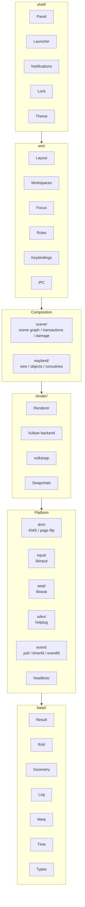
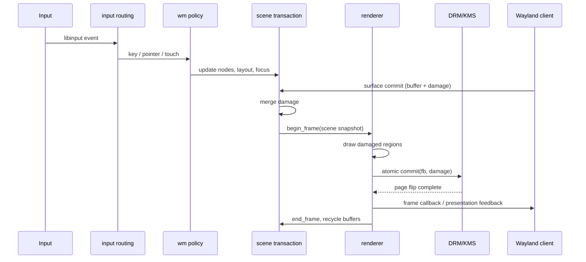

# powerwm architecture

> Status: target architecture, with early implementations in place.  
> This document describes what is being built and why; progress lives in the roadmap.

## 1. Goals and constraints

### Goals

1. Own the frame lifecycle: input, scene updates, rendering, atomic commit, page flip.
2. Separate policy (layout, focus, keybindings) from mechanism (scene, renderer, protocol).
3. Start single-threaded for correctness; add concurrency only with measurements.
4. Keep backends replaceable: DRM/KMS, headless, optional nested.
5. Keep protocol semantics independent from window-management policy.

### Constraints

- Linux only: DRM/KMS, libinput, libudev, libseat, logind/seatd.
- GCC 16+, C++26, CMake + Ninja.
- No wlroots, Mutter, KWin, or libwayland in powerwm.
- No exceptions: errors use `pwm::result<T>`.
- Vulkan only for hardware rendering; `vulkanpp` wraps all Vulkan C API.
- Every C API has `create`/`destroy` + `pwm::raii`; callers guarantee valid objects.
- Reflection is isolated; core logic must compile without it.
- Headless operation must be testable.

## 2. Layers



Dependency rules:

- Dependencies point downward only.
- `base` depends on no project module and no Wayland/DRM/Vulkan.
- `platform` knows nothing about `scene`, `wm`, or `shell`.
- `render` knows drawable resources and frames, not Wayland surfaces or windows.
- `vulkanpp` knows only Vulkan C API.
- `wayland` translates protocol to scene operations and back.
- `wm` modifies scene and policy state; it does not call the renderer.
- `shell` uses the same scene/render path as third-party clients.
- Business code must not include C headers for DRM, Vulkan, Wayland, Linux, or POSIX.

## 3. Directory plan

```text
powerwm/
├── cmake/                    # CMake modules, build-info template
├── containers/               # reproducible development environment
├── docs/                     # English docs + Chinese README
├── include/pwm/              # minimal public headers
├── protocols/                # vendored Wayland XML
├── src/
│   ├── app/                  # application entry point
│   ├── base/                 # result, raii, fatal, types, macros
│   ├── event/                # target: coroutine scheduler
│   ├── platform/
│   │   ├── drm/              # device, atomic requests, buffers, page flips
│   │   ├── event/            # poll, timerfd, eventfd
│   │   ├── input/            # libinput context and events
│   │   ├── seat/             # libseat session and devices
│   │   ├── udev/             # hotplug monitor
│   │   ├── gbm/              # early GBM wrapper (may be removed)
│   │   └── headless/         # headless output
│   ├── render/
│   │   ├── vulkan/           # target: compositor backend
│   │   └── vulkanpp/         # Vulkan RAII: pipeline/image/DMA-BUF/KMS
│   ├── scene/
│   ├── wayland/
│   │   ├── wire/
│   │   ├── object/
│   │   ├── protocol/
│   │   └── globals/
│   ├── wm/
│   ├── shell/
│   ├── config/
│   └── ipc/
├── tests/
│   ├── unit/
│   ├── integration/
│   ├── golden/
│   ├── fuzz/
│   └── bench/
└── tools/                    # probes, bring-up demos, policy scripts
```

### Migration from the prototype

| Prototype | Target |
| --- | --- |
| `helpers/` | `base/` (done) |
| `libdrmpp/` | `platform/drm/` (done) |
| `libgbmpp/` | `platform/gbm/` or remove |
| `main.cpp` | `app/main.cpp` (done) |
| `libdrmpp` target | `powerwm_core` + `powerwm` (done) |
| — | `event/`, `render/vulkanpp/` (partly done) |
| — | `wayland/`, `wm/`, `shell/`, `config/` |

## 4. Threading and event loop

### Default: one logical thread

```text
pwm::platform::event::event_loop (poll)
├── Wayland client sockets (future)
├── DRM fd: page flip / vblank
├── libinput fd: input events
├── timerfd: frame pacing, key repeat, animation deadlines
├── signalfd: SIGINT/SIGTERM/SIGCHLD
├── udev monitor: hotplug
└── IPC socket: control requests
```

libseat has its own dispatch; it is called from the loop tick because it does not expose a
pollable fd. The target coroutine scheduler will integrate all sources.

Invariants:

- Scene, window, and protocol state are touched only on the main thread.
- The main thread never blocks; heavy work goes to workers or processes.
- Rendering starts on the main thread. A render thread, if introduced, receives immutable
  scene snapshots through an SPSC queue.
- Signal handlers only set flags or write signalfd.
- Coroutines resume only on their owning event-loop thread.
- Input must not be blocked by animation.

### Coroutine runtime (target)

```cpp
namespace pwm::event {
template <typename T = void> class task;   // lazy, stores result<T>
task<void> client_session(wayland::connection& conn);
task<message> read_message(wayland::connection& conn);
}
```

Rules:

- `task<T>` is lazy; starting or `co_await` advances it.
- Errors live inside `task<T>`; `co_await` short-circuits, no exceptions.
- Every suspension registers with the event loop (fd, timer, explicit resume).
- Parent/loop owns the coroutine; no detach; no implicit resume in destructors.
- Cancellation is an error code, not an exception.

### Cost of not using libwayland

| Area | Must implement | Risk |
| --- | --- | --- |
| Wire format | header, arguments, versions, opcodes | incompatibility |
| FD passing | sendmsg/recvmsg + SCM_RIGHTS | leaks, truncation |
| Object model | IDs, destruction, versions, interfaces | dangling objects |
| Protocol description | XML parser/code generator | generator bugs |
| Event loop | epoll + coroutine scheduling | starvation, cancellation |
| Tests | in-tree client + protocol fuzzing | compatibility gaps |

## 5. Frame lifecycle



Frame rules:

1. Page-flip driven; never queue a new frame without a completed flip.
2. Idle when there is no animation, input, or new damage.
3. Merge updates within one loop iteration into one commit.
4. Animation uses absolute monotonic time; dropped frames do not change speed.
5. Degrade effects before missing the frame budget.

Damage levels:

| Level | Source | Merge |
| --- | --- | --- |
| Surface | `wl_surface.damage`, buffer updates | local coordinates, scaled |
| Scene | movement, transform, opacity, stacking | old bounds ∪ new bounds |
| Output | composition result | screen coordinates, clipped to output |

KMS damage must be conservative: overdraw rather than miss.

## 6. Core modules

### base/

- `result<T>` = `std::expected<T, error>`; error code, static message, source location,
  optional system errno.
- `raii<T, Args...>`: owns once, movable, no validity checks.
- `fatal`: structured fatal termination.
- fixed-width aliases, geometry, logging, time, reflection helpers.

### platform/drm/

- device enumeration, atomic capability detection, connector/CRTC/plane model;
- cached property IDs, atomic requests, dumb buffers, DMA-BUF framebuffer import;
- page-flip events, VT pause/resume, output selection;
- **not** responsible for what to draw.

### platform/event/

- `poll`-based multi-fd event loop;
- `eventfd`, `timerfd` RAII;
- page-flip wait helper;
- target: epoll coroutine scheduler.

### platform/input/

- libinput + udev context, normalized keyboard/pointer/touch events;
- device hotplug handled by libinput;
- input routing/focus is a higher layer.

### platform/seat/

- libseat session, device opening, enable/disable callbacks;
- DRM opens through seat when available, direct fallback otherwise;
- VT disable pauses commits; enable retries master and recommits.

### platform/udev/

- DRM hotplug monitor;
- filters self-generated `change` events using `HOTPLUG`;
- hotplug restarts the output runtime safely.

### render/vulkanpp/

- instance, physical/logical device, queue;
- command pool/buffer, fence, submit;
- image, readback buffer, offscreen clear;
- DMA-BUF export and KMS framebuffer import;
- render pass, graphics pipeline, shader modules, fullscreen triangle;
- textured scene renderer with rounded corners, shadows, blur, transforms, and clipping;
- damage-scissored partial redraw and cached per-image framebuffers;
- all Vulkan C API stays in this layer; business code sees project types.

Target renderer:

```cpp
class renderer {
public:
    virtual ~renderer() = default;
    virtual auto begin_frame(const frame_context&) -> result<void> = 0;
    virtual auto draw(const draw_list&) -> result<void> = 0;
    virtual auto end_frame() -> result<frame_result> = 0;
};
```

- Vulkan renders to exportable images; DMA-BUF goes to KMS.
- Client DMA-BUFs import as Vulkan images; modifiers/format fall back when needed.
- Explicit fences/semaphores; no resource reuse before page flip completion.
- Headless tests use lavapipe/llvmpipe.

### scene/

Implemented: `node` parent/child tree, styles (fill, texture, radius, shadow, blur,
transform, opacity, child clipping), `transaction` move/show changes, surface invalidation,
and scene damage collection. The Vulkan scene renderer consumes the tree directly.

```text
output_node
└── layer_node (background / bottom / normal / top / overlay)
    ├── surface_node
    ├── container_node
    └── effect_node (shadow / blur / rounded / opacity)
```

- nodes hold parent/children, transforms relative to parent;
- transactions collect changes and swap atomically, producing damage;
- surface state is pending/current with Wayland commit semantics;
- client buffers are reference-counted and never freed while the GPU uses them.

### wayland/

- in-tree wire protocol, object table, IDs, versions, destruction, errors;
- XML parser and C++ descriptor generator, no `wayland-scanner`;
- one `client_session` coroutine per connection;
- protocol parameters are validated; malformed input returns protocol errors;
- input focus and scene focus are separate.

### wm/

- layout: pure functions from workspace/windows to rectangles;
- workspaces per output, cross-output moves;
- focus stack and rules; one entry point for focus changes;
- declarative window rules and modular keybinding modes;
- JSON-lines IPC with request IDs and a whitelisted action set.

### shell/

- panel, launcher, notifications, lock screen use normal scene surfaces;
- theme tokens: color, radius, spacing, typography, shadows, curves;
- one animation timeline with reduced-motion and low-performance modes.

### config/

- TOML with file/line/column diagnostics;
- defaults → system → user → runtime overrides;
- atomic hot reload; failed parse keeps the previous config.

## 7. Backends

```cpp
struct backend {
    virtual ~backend() = default;
    virtual auto outputs() -> std::span<output*> = 0;
    virtual auto dispatch() -> result<void> = 0;
    virtual auto commit(const output&, const frame&) -> result<void> = 0;
};
```

| Backend | Purpose | Status |
| --- | --- | --- |
| DRM | real hardware | Phase 1 |
| headless | CI, golden images, protocol tests | Phase 1 |
| nested | debugging inside an existing Wayland session | optional |

Backends output frames; they do not build scenes. Headless must be deterministic.

## 8. Errors and crash policy

| Situation | Policy |
| --- | --- |
| Client protocol error | protocol error, disconnect client, keep compositor alive |
| Invalid client buffer | ignore commit, log, request redraw |
| Recoverable DRM commit failure | full redraw/degrade, retry once |
| Fatal DRM failure | attempt session recovery; otherwise exit safely |
| Config error | keep previous config, print location |
| Broken invariant | `PWM_ASSERT`, terminate, supervisor restarts |
| OOM | drop caches/degrade; otherwise exit safely |

### Error model

- `-fno-exceptions`; no `throw`/`try`/`catch`.
- Recoverable failures return `pwm::result<T>`.
- `error` carries a code, static message, source location, optional errno.
- Coroutines carry `result<T>` internally and short-circuit.
- Only broken invariants or unrecoverable startup failures terminate.
- Standard library calls that can throw must be guarded by validation or compile-time checks.

## 9. Security

- Never run as root; obtain devices through libseat/logind.
- Treat every client byte as untrusted: lengths, enums, coordinates, fds.
- `O_CLOEXEC` everywhere; `SCM_RIGHTS` validates fd type.
- IPC socket `0600`, same user only, action allowlist.
- Config command execution requires explicit opt-in.
- Fuzz protocol objects, config parser, IPC parser.
- Future: seccomp, Landlock, allocator hardening.

## 10. Observability

- Logs: `PWM_LOG=category=debug`; default info.
- Stats: frame time, dropped frames, commits, per-client buffers, scene nodes.
- Tracing: optional perfetto/tracing markers.
- Diagnostics: `powerwm --doctor`, `powerwm_probe`, Vulkan and input probes.
- IPC: outputs, windows, frame stats.

## 11. Key invariants

1. A `wl_surface` has at most one pending and one current state.
2. A framebuffer submitted to KMS is not freed or reused before page flip completion.
3. Scene parent pointers and child lists stay consistent.
4. Output damage is clipped to output bounds.
5. Focused surfaces belong to the active workspace or an explicit override layer.
6. Destroyed protocol objects never receive late events.
7. Config hot reload is atomic.
8. Animation uses monotonic time, not frame counts.
9. Coroutines resume only on their event-loop thread; cancelled coroutines touch nothing.
10. Every `Vk*` handle is destroyed through `vulkanpp`; exported images stay alive while KMS uses them.
11. Every C API resource has exactly one `destroy`; `raii` ownership is auditable.

## 12. Open questions

- When to introduce C++26 modules, and where to draw header/module boundaries.
- Retained vs immediate scene graph; current preference is retained + transactions.
- Whether config needs a scripting extension.
- Whether a plugin ABI exists before 1.0; current answer is no.
- Minimum viable HDR/color management.
- Whether `vulkanpp` remains internal or becomes a reusable library.
- Protocol XML generator implementation: C++ or a separate script.
