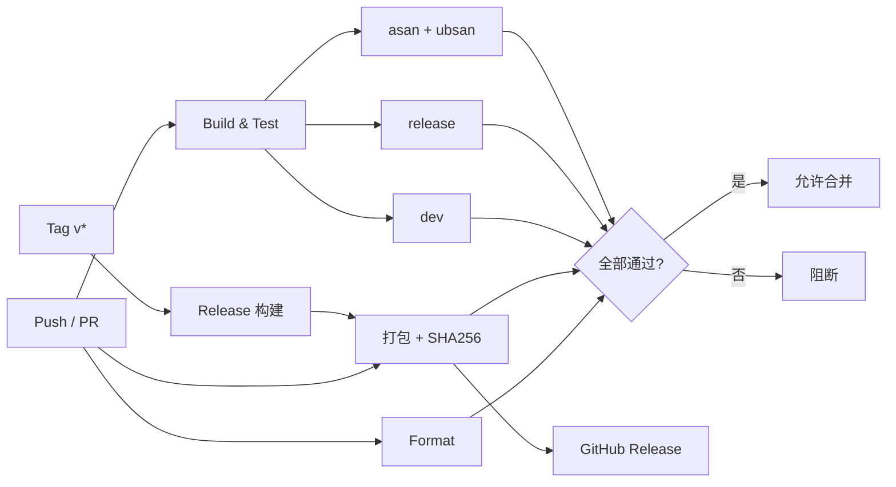

# powerwm CI/CD

> 目标：**本地一条命令，CI 同一套流程；main 永远可构建、可测试、可发布。**

当前流水线文件：

- [`.github/workflows/ci.yml`](../.github/workflows/ci.yml) — 格式、Debug/Release/ASan+UBSan 构建与测试。
- [`.github/workflows/release.yml`](../.github/workflows/release.yml) — 标签发布与打包。
- [`CMakePresets.json`](../CMakePresets.json) — 本地与 CI 共用的构建预设。
- [`containers/dev.Dockerfile`](../containers/dev.Dockerfile) — 可复现 GCC 16 环境。
- [`.github/dependabot.yml`](../.github/dependabot.yml) — Actions 与容器依赖更新。

> 本文假设使用 GitHub Actions。若迁移到 GitLab CI/其他平台，保持**阶段与门禁**不变，只替换执行器。

---

## 1. 流水线总览



### 任务矩阵

| 任务 | 预设 | 内容 | 阻断合并 |
| --- | --- | --- | --- |
| `format` | — | `clang-format --dry-run --Werror` | 是 |
| `policy` | — | 禁止异常 / libwayland / 裸 C API / `int32_t` | 是 |
| `build (dev)` | `dev` | Debug 构建 + CTest | 是 |
| `build (release)` | `release` | Release 构建 + CTest | 是 |
| `build (asan)` | `asan` | ASan + UBSan 构建 + CTest | 是 |
| `release` | `release` | 标签构建、打包、发布 | 发布阻断 |

触发条件：

- `push` 到 `main`/`master`；
- 任意 `pull_request`；
- 每日 `03:17 UTC` 定时构建（捕捉依赖/工具链漂移）；
- 手动 `workflow_dispatch`；
- `v*` 标签触发发布。

并发策略：同一分支/PR 的新构建会取消旧构建（`cancel-in-progress: true`）。

---

## 2. 构建预设

| 预设 | 构建类型 | 用途 | 关键参数 |
| --- | --- | --- | --- |
| `dev` | Debug | 日常开发 | 断言开启、符号完整 |
| `release` | Release | 打包、性能测试 | 优化开启 |
| `asan` | Debug | CI 消毒器 | `-fsanitize=address,undefined -fno-sanitize-recover=all` |

本地命令：

```bash
# 配置 + 构建 + 测试（推荐日常）
cmake --preset dev
cmake --build --preset dev
ctest --preset dev --output-on-failure

# Release
cmake --preset release
cmake --build --preset release
ctest --preset release --output-on-failure

# ASan + UBSan
cmake --preset asan
cmake --build --preset asan
ctest --preset asan --output-on-failure
```

所有构建输出位于 `build/<preset>/`，不污染源码树。

所有预设都通过 CMake 的 `add_compile_options(-fno-exceptions)` 禁用异常；这是硬性规则，不因本地构建方式改变。

### 2.1 构建元数据

`cmake/PowerWMBuildInfo.cmake` 在配置阶段采集并生成 `powerwm/build_info.hpp`：

- 项目版本；
- git commit（完整/短）、分支、`git describe`、dirty 状态；
- UTC 构建时间；
- 构建类型、编译器 id/版本/路径、生成器、C++ 标准；
- 编译参数、构建目录、启用特性、目标系统与处理器。

本地查看：

```bash
cmake --preset dev
cmake --build --preset dev
./build/dev/powerwm --build-info
```

`.git/HEAD` 与当前分支 ref 被加入 `CMAKE_CONFIGURE_DEPENDS`，提交后再次构建会自动刷新元数据。无 `.git` 时字段回退为 `unknown`。

### 环境变量

| 变量 | 作用 |
| --- | --- |
| `ASAN_OPTIONS=detect_leaks=1:abort_on_error=1` | 开启泄漏检测，错误即中止 |
| `UBSAN_OPTIONS=halt_on_error=1:print_stacktrace=1` | UB 立即失败并打印栈 |
| `CC` / `CXX` | 指定编译器（默认 GCC 16） |

CI 默认使用官方 `gcc:16` 容器；当前安装 `libdrm-dev`、`libvulkan-dev`、`vulkan-validationlayers`、`mesa-vulkan-drivers`，后续按模块增加 `libinput-dev`、`libudev-dev`、`libseat-dev` 等。**不安装、不链接 `libwayland-*`。**

---

## 3. 格式门禁

```bash
# 本地修复
clang-format -i $(git ls-files '*.cpp' '*.hpp' '*.h')

# 本地检查（与 CI 一致）
clang-format --dry-run --Werror $(git ls-files '*.cpp' '*.hpp' '*.h')
```

- 版本固定为 `23.1.5`（见 CI）；不同版本可能产生不同换行，**以 CI 为准**。
- 格式变更单独提交，避免与逻辑变更混在一起。
- 不要用 `// clang-format off` 逃避；确有必要时注明原因与范围。

### 3.1 策略门禁

```bash
bash tools/check_policy.sh
python3 tools/check_comments.py
```

检查项：

| 规则 | 失败示例 |
| --- | --- |
| 无 libwayland | `#include <wayland-server.h>` |
| 无异常 | `try { ... } catch (...)`、`throw` |
| 使用 `pwm` 整数别名 | `std::uint32_t id`（`types.hpp` 除外） |
| C API 封装 | 业务层直接 `::open()`、`drmMode*()`、`vkCreate*()` |
| C 头隔离 | `scene/` 中 `#include <drm/...>` |
| 注释策略 | 禁止解释性注释；只允许英文 `///` / `/**` API 文档注释 |

封装层白名单：`src/base/`、`src/platform/`、`src/render/vulkanpp/`。

---

## 4. 静态分析与未来门禁

| 门禁 | 状态 | 说明 |
| --- | --- | --- |
| clang-format | 已启用 | 阻断 |
| 仓库策略扫描 | 已启用 | 阻断：无异常、无 libwayland、C API 封装、整数别名 |
| 编译器警告 | Phase 0 | 先清理，再启用 `-Werror` |
| clang-tidy | Phase 0/1 | Clang 尚不能解析 C++26 反射；先在非反射文件启用 |
| 单元/集成测试 | Phase 0 | CTest 骨架已就绪 |
| 金图测试 | Phase 2 | headless 渲染确定性输出 |
| 性能基准 | Phase 2 | 阈值比较，防回归 |
| 模糊测试 | Phase 3 | 每日/发布前运行 |
| 硬件冒烟 | Phase 1 | 自托管 runner 或手动发布检查 |

> 原则：**先建立基线，再设阻断**。没有基线的告警数不胜数，直接 `-Werror` 只会让人绕过 CI。

---

## 5. 分支与合并策略

采用 trunk-based development：

```text
main ──●──●──────●──────●──►
        \        /        \
         ●──●──●          ●──●  (短生命周期分支 / PR)
```

- `main` 始终可构建、可测试；不直接推送，必须走 PR。
- 分支命名：`feat/<scope>-<short>`、`fix/<scope>-<short>`、`docs/<topic>`、`ci/<topic>`。
- PR 尽量小（< 400 行有效变更），一个 PR 只做一件事。
- 合并方式：squash merge（保持线性历史）；提交信息遵循 Conventional Commits。
- 发布分支：仅在需要维护旧版本时创建 `release/0.x`，否则直接用标签。

### 建议的分支保护

| 设置 | 值 |
| --- | --- |
| Require pull request | 是 |
| Required approvals | 1（核心模块 2） |
| Required status checks | `Format (clang-format)`、`Policy`、`Build & Test (dev)`、`Build & Test (release)`、`Build & Test (asan)` |
| Require branches up to date | 是 |
| Require conversation resolution | 是 |
| Allow force push | 否 |
| Allow deletions | 否 |

---

## 6. 发布流程

### 版本号

预发布阶段使用 `0.x.y`：

- `0.x.0`：阶段里程碑（例如 Phase 3 完成）。
- `0.x.y`：修复与兼容改进。
- 1.0 后遵循 SemVer；ABI/配置兼容策略见 `CHANGELOG.md`。

### 步骤

1. 确认 `main` 全绿，性能与兼容性检查完成。
2. 更新 `CHANGELOG.md`（新增、变更、修复、破坏性变更）。
3. 打标签并推送：

```bash
git tag -a v0.1.0 -m "powerwm v0.1.0: stable KMS bring-up"
git push origin v0.1.0
```

4. `release.yml` 自动执行：
   - Release 构建与测试；
   - 打包 `powerwm-<version>-linux-x86_64.tar.gz`；
   - 生成 `SHA256SUMS`；
   - 创建 GitHub Release 并附发布说明。
5. 下载产物，在干净环境验证安装/运行。
6. 需要时补充发行版包（AUR、Debian、COPR），Phase 6 接入。

> 当前 Phase 0 打包应用骨架 `powerwm` 与点灯工具 `powerwm_drm_bringup`；发布说明必须明确“不可日常使用”。

### 回滚

- 代码回滚：`git revert` 并走正常 PR；不要强推 `main`。
- 发布回滚：删除错误标签/Release，发布新的补丁版本；已下载产物无法召回，必须在说明中标注。
- 配置破坏性变更：提供迁移脚本与至少一个版本的弃用警告。

---

## 7. 依赖管理

- 系统库（libdrm、libinput、Vulkan loader、mesa-vulkan-drivers）：使用发行版包，CI 容器固定基础镜像。
- 头文件库（如 `toml++`）：`FetchContent` + 固定 tag/commit + SHA256。
- 不在仓库中提交第三方源码，除非许可证与审计要求。
- 升级依赖必须单独 PR，说明变更、测试与性能影响。
- Dependabot 每周检查 GitHub Actions 与开发容器基础镜像。

---

## 8. 缓存与产物

Phase 0 暂不启用编译缓存（项目小，缓存维护成本更高）。Phase 1 起计划：

- `ccache`：缓存 `build/*/CMakeFiles` 的编译结果，键包含编译器版本与预设。
- CMake 配置缓存：缓存 `~/.cache/cmake`（谨慎，易产生脏状态）。
- 测试产物：JUnit XML、覆盖率、金图差异图，保留 14 天。
- 发布产物：永久保留在 GitHub Release。

---

## 9. 安全与权限

- `ci.yml` 使用 `permissions: contents: read`，最小权限。
- `release.yml` 仅在标签触发时需要 `contents: write`。
- 不在 PR 构建中注入 secrets；不在日志中打印 token。
- 来自 fork 的 PR 不自动运行需要写权限的步骤。
- 发布签名（GPG/Sigstore）在 Phase 7 接入。

---

## 10. 本地复现 CI

### 使用容器（推荐）

```bash
docker build -t powerwm-dev -f containers/dev.Dockerfile .
docker run --rm -it -v "$PWD:/workspace" -w /workspace powerwm-dev

# 容器内
cmake --preset dev && cmake --build --preset dev && ctest --preset dev --output-on-failure
```

### 不使用容器

确保：

```bash
g++ --version   # >= 16
cmake --version # >= 3.25
ninja --version
pkg-config --modversion libdrm
```

然后运行与 CI 相同的三条命令。

---

## 11. 排障

| 现象 | 可能原因 | 处理 |
| --- | --- | --- |
| `-freflection` 未识别 | 编译器不是 GCC 16+ | 使用容器或安装 GCC 16 |
| `FindLibdrm` 失败 | 缺少 `libdrm-dev` / pkg-config | 安装开发包，检查 `pkg-config --modversion libdrm` |
| 格式检查失败但本地通过 | clang-format 版本不同 | 使用 CI 固定版本 `23.1.5` |
| CTest 找不到测试 | 未启用 `include(CTest)` 或未构建 | 重新配置；Phase 0 后会有实际测试 |
| ASan 报泄漏 | 全局缓存/第三方库 | 先确认是否真实泄漏；必要时添加有注释的抑制 |
| 容器内 checkout 失败 | 镜像缺少 git/ca-certificates | 在 checkout 前安装依赖（当前流程已处理） |

---

## 12. 后续增强

按阶段逐步加入，避免一次性堆叠复杂度：

- [ ] Phase 0：编译器警告基线 + `-Werror`；clang-tidy（非反射文件）。
- [ ] Phase 0：测试报告与覆盖率上传。
- [ ] Phase 1：真实硬件自托管 runner 冒烟（DRM/KMS、VT 切换）。
- [ ] Phase 2：headless 金图测试与性能基准阈值。
- [ ] Phase 3：Wayland 协议模糊测试（每日）。
- [ ] Phase 5：文档站点与截图预览。
- [ ] Phase 6：多发行版打包（AUR/Debian/COPR）。
- [ ] Phase 7：可复现构建、产物签名、SBOM。
