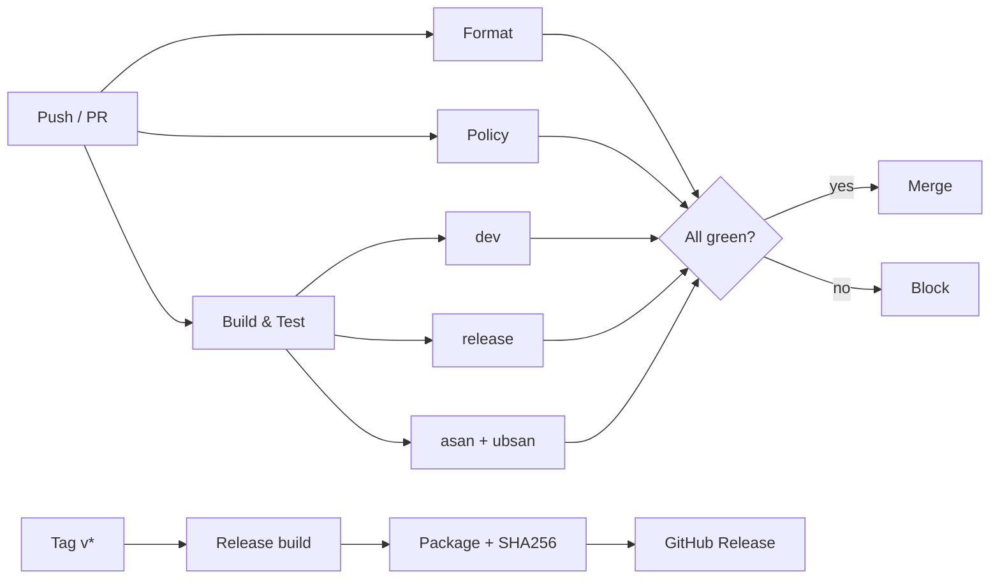

# CI/CD

> Goal: one local command, the same flow in CI; `main` is always buildable, testable, and
> releasable.

Files:

- [`.github/workflows/ci.yml`](../.github/workflows/ci.yml) — format, policy, builds, tests.
- [`.github/workflows/release.yml`](../.github/workflows/release.yml) — tagged releases.
- [`CMakePresets.json`](../CMakePresets.json) — shared presets.
- [`containers/dev.Dockerfile`](../containers/dev.Dockerfile) — reproducible GCC 16 environment.
- [`.github/dependabot.yml`](../.github/dependabot.yml) — Actions/container updates.

This assumes GitHub Actions. Other CI systems should preserve the same gates.

## 1. Pipeline



| Job | Preset | Content | Blocking |
| --- | --- | --- | --- |
| `format` | — | `clang-format --dry-run --Werror` | yes |
| `policy` | — | no exceptions/libwayland/bare C API/`int32_t`/comments | yes |
| `build (dev)` | `dev` | Debug build + CTest | yes |
| `build (release)` | `release` | Release build + CTest | yes |
| `build (asan)` | `asan` | ASan + UBSan build + CTest | yes |
| `release` | `release` | tag build, package, publish | release-blocking |

Triggers: push to `main`/`master`, pull requests, daily cron, manual dispatch, `v*` tags.
Concurrent runs for the same ref are cancelled.

## 2. Presets

| Preset | Type | Purpose | Key flags |
| --- | --- | --- | --- |
| `dev` | Debug | daily development | assertions, symbols |
| `release` | Release | packaging/performance | optimization |
| `asan` | Debug | sanitizers | `-fsanitize=address,undefined -fno-sanitize-recover=all` |

```bash
cmake --preset dev
cmake --build --preset dev
ctest --preset dev --output-on-failure

cmake --preset release
cmake --build --preset release
ctest --preset release --output-on-failure

cmake --preset asan
cmake --build --preset asan
ctest --preset asan --output-on-failure
```

All builds go to `build/<preset>/`. All presets use
`add_compile_options(-fno-exceptions)`.

### Environment

| Variable | Effect |
| --- | --- |
| `ASAN_OPTIONS=detect_leaks=1:abort_on_error=1` | leak detection, abort on error |
| `UBSAN_OPTIONS=halt_on_error=1:print_stacktrace=1` | stop on UB, print stack |
| `CC` / `CXX` | compiler selection |

CI uses `gcc:16` and installs `libdrm-dev`, `libinput-dev`, `libseat-dev`, `libudev-dev`,
`libvulkan-dev`, `glslang-tools`, `vulkan-validationlayers`, `mesa-vulkan-drivers`. It does not install or
link libwayland.

### Build metadata

`cmake/PowerWMBuildInfo.cmake` generates `powerwm/build_info.hpp` with:

- version;
- full/short git commit, branch, describe, dirty state;
- UTC build time;
- build type, compiler id/version/path, generator, C++ standard;
- flags, build directory, features, target system/processor.

```bash
./build/dev/powerwm --build-info
```

`.git/HEAD` and the current branch ref are configure dependencies, so commits refresh the
metadata. Missing `.git` falls back to `unknown`.

## 3. Format and policy gates

```bash
clang-format -i $(git ls-files '*.cpp' '*.hpp' '*.h')
clang-format --dry-run --Werror $(git ls-files '*.cpp' '*.hpp' '*.h')

bash tools/check_policy.sh
python3 tools/check_comments.py
```

Policy checks:

| Rule | Violation example |
| --- | --- |
| no libwayland | `#include <wayland-server.h>` |
| no exceptions | `try`, `catch`, `throw` |
| integer aliases | `std::uint32_t id` (except `types.hpp`) |
| C API wrapping | bare `::open()`, `drmMode*()`, `vkCreate*()` in business code |
| C header isolation | `#include <drm/...>` in `scene/` |
| comments | explanatory comments; non-English API docs |

Wrapper allowlist: `src/base/`, `src/platform/`, `src/render/vulkanpp/`.

clang-format is pinned to `23.1.5`; different versions may reflow differently.

## 4. Static analysis and future gates

| Gate | Status | Notes |
| --- | --- | --- |
| clang-format | enabled | blocking |
| policy scan | enabled | blocking |
| compiler warnings | Phase 0 | clean, then `-Werror` |
| clang-tidy | Phase 0/1 | Clang cannot parse C++26 reflection yet |
| unit/integration | Phase 0 | CTest live |
| golden images | Phase 2 | deterministic headless output |
| benchmarks | Phase 2 | threshold comparisons |
| fuzzing | Phase 3 | daily/release |
| hardware smoke | Phase 1 | self-hosted runner or manual |

## 5. Branching

- Trunk-based; `main` always green.
- Branch names: `feat/<scope>-<topic>`, `fix/...`, `docs/...`, `ci/...`.
- PRs under 400 effective lines; squash merge; Conventional Commits.
- `release/0.x` only when maintaining an old line.

Branch protection:

| Setting | Value |
| --- | --- |
| Require PR | yes |
| Approvals | 1 (2 for core) |
| Required checks | `Format (clang-format)`, `Policy`, `Build & Test (dev)`, `Build & Test (release)`, `Build & Test (asan)` |
| Up-to-date branch | yes |
| Conversation resolution | yes |
| Force push | no |
| Deletion | no |

## 6. Releases

Pre-1.0 uses `0.x.y`:

- `0.x.0` for phase milestones;
- `0.x.y` for fixes;
- SemVer after 1.0.

1. Ensure `main` is green and validation passed.
2. Update `CHANGELOG.md`.
3. Tag and push:

```bash
git tag -a v0.1.0 -m "powerwm v0.1.0"
git push origin v0.1.0
```

4. `release.yml` builds, tests, packages, writes `SHA256SUMS`, and creates the release.
5. Verify the artifact in a clean environment.
6. Add distribution packages in Phase 6.

Rollback: revert code via PR, delete/publish a corrected tag, document broken artifacts.

## 7. Dependencies

- System libraries from distribution packages; CI pins the base image.
- Header-only libraries via `FetchContent` with tag/commit and SHA256.
- No vendored third-party source without license/audit review.
- Dependency updates are separate PRs with tests and impact notes.
- Dependabot checks Actions and the dev container weekly.

## 8. Caching and artifacts

Phase 0 does not use ccache. Later:

- ccache keyed by compiler version and preset;
- test artifacts: JUnit, coverage, golden diffs, 14 days;
- release artifacts: permanent in GitHub Releases.

## 9. Security

- `ci.yml` uses `contents: read`.
- `release.yml` uses `contents: write` only for tags.
- No secrets in PR builds; no tokens in logs.
- Fork PRs do not run write-permission steps.
- Signing (GPG/Sigstore) in Phase 7.

## 10. Reproducing CI locally

```bash
docker build -t powerwm-dev -f containers/dev.Dockerfile .
docker run --rm -it -v "$PWD:/workspace" -w /workspace powerwm-dev

cmake --preset dev && cmake --build --preset dev && ctest --preset dev --output-on-failure
```

Native requirements: `g++ >= 16`, CMake >= 3.25, Ninja, pkg-config, libdrm.

## 11. Troubleshooting

| Symptom | Cause | Fix |
| --- | --- | --- |
| `-freflection` unknown | compiler older than GCC 16 | use container or install GCC 16 |
| `FindLibdrm` fails | no libdrm-dev/pkg-config | install and check `pkg-config --modversion libdrm` |
| format fails locally | clang-format version differs | use 23.1.5 |
| CTest finds no tests | no `include(CTest)`/build | reconfigure and build |
| ASan leak | real leak or global cache | verify, then add documented suppression |
| checkout fails in container | no git/ca-certificates | install before checkout |

## 12. Future work

- Phase 0: warnings as errors; clang-tidy on non-reflection files; test reports/coverage.
- Phase 1: self-hosted hardware runner; resource/fd checks.
- Phase 2: golden images and benchmark thresholds.
- Phase 3: daily protocol fuzzing.
- Phase 5: docs site and screenshots.
- Phase 6: AUR/Debian/COPR packaging.
- Phase 7: reproducible builds, signing, SBOM.
